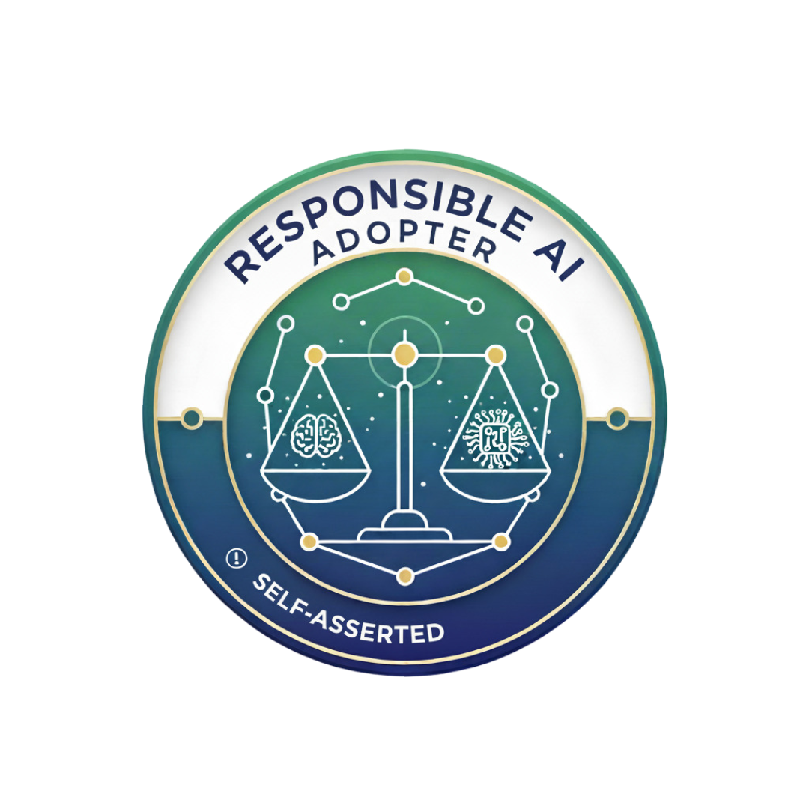

# 🛡️ Responsible AI Adopter Badge

This repository hosts the Responsible AI Adopter Badge, a freely available, open-source image designed for individuals, projects and organizations wishing to visually signal their personal or organizational commitment to leveraging ethical and responsible AI practices.

## The Badge

The final transparent badge image is saved in the `assets/` directory of this repository.

### Image Preview



## ⚠️ MANDATORY DISCLAIMER

**THE BADGE IS SELF-ASSERTED AND UNVERIFIED.**

By using this badge, you acknowledge and agree to the following terms:

- **Self-Assertion Only:** This badge is granted solely upon self-declaration by the user. No verification, audit, or review of the recipient’s knowledge, systems, or practices has been conducted by the repository maintainer(s) or any associated entity.
- **No Credibility Implied:** The badge holds no official certification, accreditation, or third-party credibility. It is not issued by any recognized standards body, regulatory authority, or professional organization.
- **No Liability:** The badge provider (the maintainer of this repository) makes no claims or guarantees regarding the ethical nature, security, or responsibility of any system or individual displaying this badge. The badge is a symbolic token of personal or project commitment only.
- **Use at Your Own Risk:** Anyone relying on the presence of this badge must understand that it represents only a self-declared statement of intent and should not be used as a substitute for independent diligence or verification.
- **NO PAYMENT REQUIRED:** The badge is strictly free. **No one is authorized to charge money for access, use, or display of this badge or any of its assets.** Any such request or demand for payment should be reported and ignored immediately.

---

## Usage Instructions

Anyone is free to use this badge to signal their **self-declared** status as a Responsible AI Adopter.

### How to Embed the Badge

To display the badge on your website, GitHub repository, documentation, or profile, use the Markdown or HTML code snippets below, replacing `[BADGE_URL]` with the direct URL to the image file (e.g., the direct link to the PNG file on your repository’s CDN).

#### 1. Markdown (Recommended for GitHub/Readmes):

```markdown
[](<YOUR_LINK_TO_THIS_README>)
```

**Example (assuming you host on GitHub):**

```markdown
[](https://github.com/responsible-ai-badge/main/README.md)
```

#### 2. HTML (Recommended for Websites):

```html
<a href="<YOUR_LINK_TO_THIS_README>">
    " alt="Responsible AI Adopter - Self-Asserted" width="150" height="150" />
</a>
```

---

## License

The Responsible AI Adopter Badge image and all accompanying documentation (including this README) are licensed under the [Creative Commons Attribution 4.0 International Public License (CC BY 4.0)](https://creativecommons.org/licenses/by/4.0/).

**You are free to:**

- **Share** — copy and redistribute the material in any medium or format.
- **Adapt** — remix, transform, and build upon the material for any purpose, even commercially.

**Under the following condition:**

- **Attribution** — You must give appropriate credit, provide a link to the license, and indicate if changes were made. You may do so in any reasonable manner, but not in any way that suggests the licensor endorses you or your use.

For the full license text, please see the included `LICENSE.md` file in this repository.
